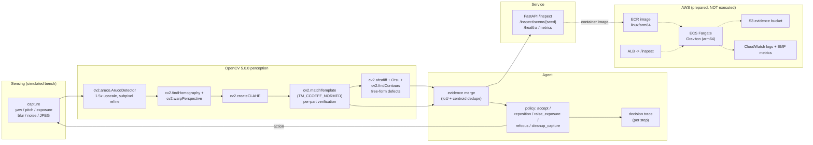

# Architecture

## Component view



Dotted edges are the AWS path that is written but **not provisioned** in this entry.

## Data flow for one inspection

1. `POST /inspect/scene/{seed}` or `POST /inspect` (image bytes).
2. `capture()` applies the current camera state (this is the only place a simulated
   sensor exists; a real deployment swaps this for `cv2.VideoCapture`).
3. `perceive()` → `register()` → rectified 1000x700 canonical panel.
4. Part verification: 6 screws + 2 labels, `TM_CCOEFF_NORMED` against the clean board.
5. Free-form: `absdiff`, Otsu on the interior, contour shape classification.
6. `_decide()` picks the next sensing action from *measured* image quality
   (markers, mean luma, Laplacian variance, per-detection confidence).
7. Loop, max 5 steps (`MAX_STEPS` in `src/agent.py`), merging evidence when two boxes
   overlap with IoU > 0.25 or share a type within 45 px of each other.
8. Verdict + full step trace returned as JSON; annotated JPEG on `/annotated/{seed}.jpg`.

## Why the pieces are where they are

- **Registration before detection.** Without rectification every downstream threshold
  depends on staging. Homography makes the whole comparison layout-relative instead of
  image-relative, which is what lets the reference board be reused.
- **Correlation for parts, differences for defects.** NCC inside a known region is
  brightness invariant, so exposure drift does not look like a missing screw. Otsu on the
  remaining interior adapts to the residual noise floor of that particular capture.
- **The agent owns the sensor.** The policy reads only quantities the perception stage
  measured; it never guesses. Each action has a stated trigger in the trace, which is what
  makes the loop auditable in the video and in the report.
- **Masking parts out of the free-form search.** Parts that are *supposed* to differ from
  the reference (missing screw) must not be re-reported as a scratch by the differencing
  stage; the interior mask removes those regions before thresholding.

## Deployment topology (prepared)

```
deploy/Dockerfile            python:3.13-slim + opencv-python-headless 5.0.0.93, multi-arch
deploy/build_and_push.sh     docker buildx --platform linux/arm64 -> ECR
deploy/ecs-taskdef.json      Fargate, cpu 1024 / mem 2048, arm64, health check /healthz
deploy/infra/main.tf         ECR + ECS cluster/service + ALB + S3 + CloudWatch log group
```

Sizing rationale: the measured per-frame CPU cost (see `docs/REPORT.md`) leaves a Graviton
Fargate task with 1 vCPU comfortably inside a real-time budget for a 1-2 fps inspection
line; no GPU is needed, which is the honest reason this workload is Arm-friendly.
